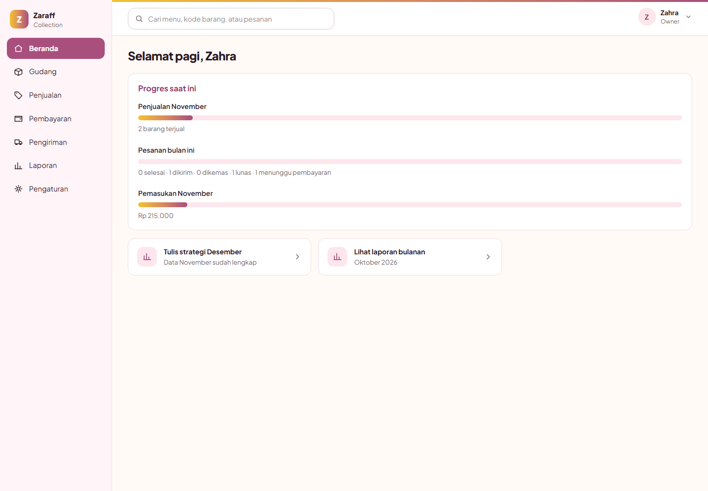
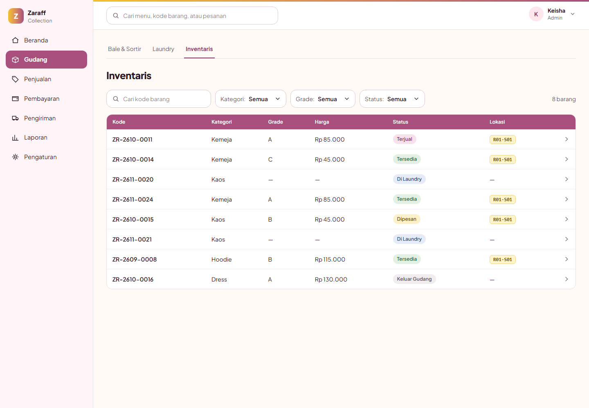
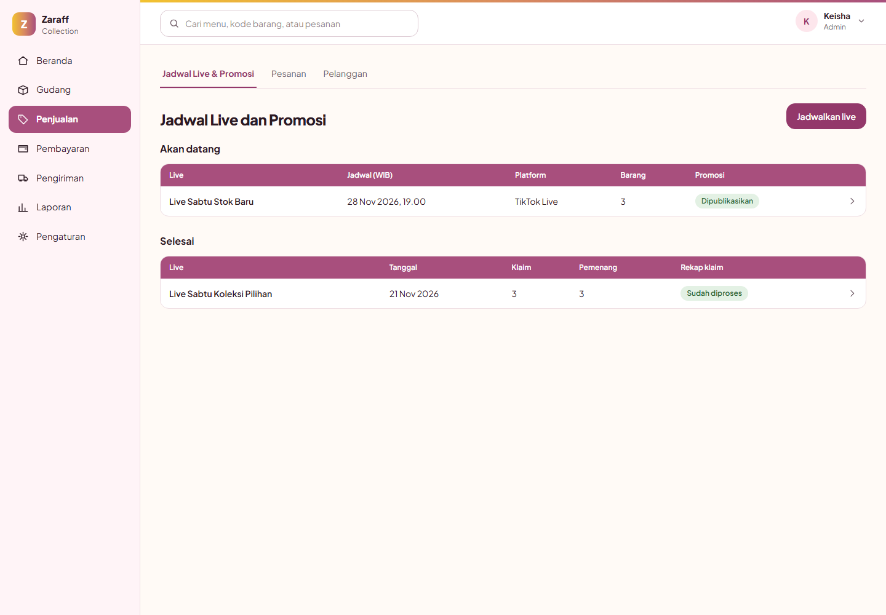
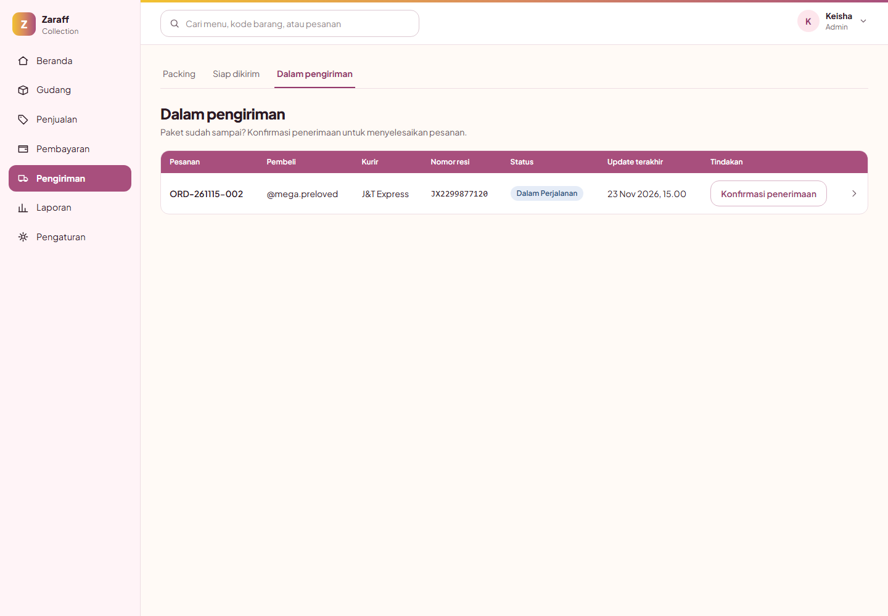

# Zaraff Collection Dashboard

Dashboard operasional untuk mengelola bale, stok, sesi live, klaim pembeli, pembayaran, packing, pengiriman, dan laporan. Frontend dan backend berjalan bersama dalam satu aplikasi Next.js dengan database SQLite lokal.

## Tampilan aplikasi

Screenshot berikut diambil langsung dari aplikasi lokal terbaru. Galeri lengkap, termasuk beranda kelima role dan halaman per modul, tersedia di [docs/screenshots](docs/screenshots/README.md).

| Beranda Owner                                                      | Inventaris barang                                                         |
| ------------------------------------------------------------------ | ------------------------------------------------------------------------- |
|  |  |

| Jadwal live                                                      | Dalam pengiriman                                                            |
| ---------------------------------------------------------------- | --------------------------------------------------------------------------- |
|  |  |

## Prasyarat

- Node.js **22.18 atau lebih baru**, beserta npm.
- Git untuk clone repository.
- Jalankan terminal dari folder utama proyek yang berisi `package.json`.

Cek versi:

```sh
node --version
npm --version
```

Jika PowerShell menampilkan `npm.ps1 cannot be loaded`, ganti `npm` dengan **`npm.cmd`** pada semua perintah di bawah, misalnya `npm.cmd ci` dan `npm.cmd run dev`.

## Setup pertama kali

### 1. Clone dan instal dependency

```sh
git clone https://github.com/keisha-sakura/II3120_Zaraff_Collection_Dashboard.git
cd IF3120_Zaraff_Collection_Dashboard
npm ci
```

Jika repository sudah ada di laptop, buka terminal di folder proyek dan cukup jalankan `npm ci`.

### 2. Buat file environment

Salin `.env.example` menjadi **`.env.local`** di folder utama proyek.

Windows PowerShell:

```powershell
Copy-Item .env.example .env.local
```

macOS / Linux:

```sh
cp .env.example .env.local
```

Penyalinan ini hanya dilakukan saat setup pertama. **Jika `.env.local` sudah ada, gunakan file tersebut** agar konfigurasi database dan API key yang sudah diisi tetap tersimpan.

Konfigurasi dasar lokal:

```dotenv
APP_NAME="Zaraff Collection Dashboard"
DATABASE_URL="./data/zaraff.sqlite"
APP_URL="http://localhost:3000"
SESSION_COOKIE_SECURE="false"
TRUST_PROXY="false"
UPLOAD_DIR="./uploads"
GEMINI_API_KEY=""
GEMINI_MODEL=""
```

`DATABASE_URL` adalah lokasi file SQLite. Folder dan file akan dibuat saat setup. Jika sudah memakai file database lain, pertahankan nilainya; semua perintah database mengikuti konfigurasi ini.

Gemini boleh dikosongkan untuk menjalankan dashboard, login, dan transaksi biasa. Pemrosesan komentar bebas membutuhkan Gemini; klaim terstruktur dapat diproses tanpa AI.

### 3. Siapkan database dan data contoh

```sh
npm run db:setup -- --small
```

Perintah ini menjalankan migration dan mengisi data ringkas:

| Data       | Isi awal                                                           |
| ---------- | ------------------------------------------------------------------ |
| Akun       | 5 akun, satu untuk setiap role                                     |
| Bale       | 2 bale                                                             |
| Barang     | 8 barang, termasuk stok tersedia dan antrean laundry               |
| Pelanggan  | 3 pelanggan                                                        |
| Live       | 2 sesi: selesai dan dipublikasikan                                 |
| Pesanan    | 3 pesanan: belum bayar, lunas menunggu packing, dan sedang dikirim |
| Pengaturan | Aturan harga, diskon member, dan lokasi gudang                     |

Transaksi contoh berada pada **November 2026**. Pilih periode tersebut ketika melihat laporan. Seed aman diulang: akun dan data awal tidak diisi kembali jika database sudah di-seed, sehingga transaksi pengguna tidak ditimpa.

### 4. Jalankan aplikasi

```sh
npm run dev
```

Tunggu sampai terminal menampilkan `Ready`, lalu buka **[http://localhost:3000/masuk](http://localhost:3000/masuk)**. Biarkan terminal tetap berjalan selama menggunakan aplikasi. Tekan **Ctrl+C** untuk menghentikan server.

Frontend dan API berjalan di server dan port yang sama; tidak perlu menjalankan backend terpisah.

### 5. Login

| Role        | Username | Password awal      | Akses utama                                                                         |
| ----------- | -------- | ------------------ | ----------------------------------------------------------------------------------- |
| Owner       | `zahra`  | `OwnerDemo!2026`   | Semua modul manajemen dan laporan                                                   |
| Admin       | `keisha` | `AdminDemo!2026`   | Modul manajemen sesuai izin, termasuk gudang, penjualan, pembayaran, dan pengiriman |
| Penyortir   | `jojo`   | `SortirDemo!2026`  | Beranda dan Gudang                                                                  |
| Live Host   | `nadia`  | `HostDemo!2026`    | Beranda dan jadwal live yang ditugaskan                                             |
| Tim Packing | `rizky`  | `PackingDemo!2026` | Beranda, antrean packing, dan checklist packing                                     |

Akun ini untuk pengembangan lokal. Jika `SEED_PASSWORD_*` diisi sebelum seed pertama, gunakan password override tersebut. Menjalankan seed ulang tidak mengganti password yang sudah tersimpan. Untuk berganti role, logout lalu login dengan akun lain.

## Menjalankan lagi setelah setup

Cukup buka terminal di folder proyek dan jalankan:

```sh
npm run dev
```

Data tetap tersimpan setelah server berhenti atau browser ditutup. Tidak perlu menyalin environment atau mengisi seed setiap kali menjalankan aplikasi.

Setelah menarik perubahan yang menambah dependency atau migration:

```sh
npm ci
npm run db:migrate
npm run dev
```

Restart server setelah mengubah `.env.local`, terutama `DATABASE_URL`.

## Mencoba alur utama

1. **Penyortir:** terima bale, sortir, catat barang layak atau retur, lalu selesaikan sortir. Proses barang laundry dengan grading, harga, dan lokasi rak hingga menjadi Tersedia.
2. **Owner/Admin:** buat jadwal live, pilih barang tersedia, lalu publikasikan. Live Host melihat jadwal penugasan; siaran dilakukan di platform live di luar aplikasi.
3. **Owner/Admin:** tandai live selesai, lalu proses klaim dari komentar manual atau CSV. Sistem menentukan pembeli pertama yang valid, mereservasi barang, dan membuat pesanan serta tagihan.
4. **Owner/Admin:** catat pengajuan transfer atau deposit, kemudian validasi. Pesanan masuk antrean packing setelah pembayaran disetujui.
5. **Tim Packing:** lengkapi checklist barang dan kemasan, lalu tandai dikemas.
6. **Owner/Admin:** buka Siap dikirim, isi kurir dan resi, lalu konfirmasi serah terima. Barang menjadi Keluar Gudang.
7. **Owner/Admin:** setelah paket diterima, buka **Pengiriman → Dalam pengiriman → Konfirmasi penerimaan**, centang paket diterima, lalu pilih **Ya, selesaikan pesanan**.

Contoh input manual dan CSV tersedia di [panduan klaim](docs/claim-comments.md). Activity diagram tersedia dalam [PNG](docs/activity-by-role.png), [SVG](docs/activity-by-role.svg), dan [penjelasan alur](docs/activity-main.md).

## Mengaktifkan Gemini

Isi dua variabel ini di `.env.local` menggunakan API key dan ID model yang tersedia untuk akunmu:

```dotenv
GEMINI_API_KEY="isi_api_key_milikmu"
GEMINI_MODEL="isi_id_model_yang_digunakan"
```

Simpan lalu restart server. Gemini memeriksa kode barang dan maksud klaim; server menentukan pemenang berdasarkan waktu valid paling awal, lalu urutan baris jika waktunya sama. API key hanya dipakai di server dan tidak diberi awalan `NEXT_PUBLIC_`.

Tanpa Gemini, gunakan CSV klaim eksplisit dengan kolom **`handle,kode,waktu`** atau form **Tambah manual**. CSV komentar dengan kolom `handle,komentar,waktu` tetap membutuhkan Gemini.

## Database dan backup

Database, `.env.local`, backup, dan file unggahan tidak ikut Git. Orang yang baru clone perlu menjalankan setup sendiri. Mengganti `DATABASE_URL` membuka file lain; data tidak otomatis dipindahkan.

| Perintah                      | Fungsi                                                 |
| ----------------------------- | ------------------------------------------------------ |
| `npm run db:setup -- --small` | Migration dan seed ringkas untuk database baru         |
| `npm run db:migrate`          | Terapkan migration tanpa seed                          |
| `npm run db:seed -- --small`  | Isi seed ringkas setelah migration jika belum ada seed |
| `npm run db:setup`            | Migration dan seed demo lengkap untuk database baru    |
| `npm run db:backup`           | Snapshot database aktif ke folder `backups/`           |

Seed lengkap memiliki transaksi September–November 2026 dan akun host pembanding `claudia` / `HostClaudia!2026`. Memilih `--small` pada database yang sudah di-seed tidak mengecilkan data lama.

### Membuat backup

```sh
npm run db:backup
```

Terminal menampilkan lokasi `backups/zaraff-<timestamp>.sqlite`. Backup memakai SQLite backup API dan dapat dijalankan saat server aktif. Salin juga folder `uploads/` jika membutuhkan bukti transfer, karena file gambar disimpan terpisah dari database.

Untuk membuat database baru sambil mempertahankan yang lama:

1. Buat backup dan hentikan server dengan Ctrl+C.
2. Ubah `DATABASE_URL` di `.env.local` ke nama file baru, misalnya `./data/zaraff-baru.sqlite`.
3. Jalankan `npm run db:setup -- --small`, kemudian `npm run dev`.

Untuk restore, saat server berhenti, salin backup ke lokasi baru lalu arahkan `DATABASE_URL` ke file salinan itu. Jangan membawa file `-wal`/`-shm` dari database lain. Metadata unggahan saat ini memakai path absolut, sehingga pindah komputer memerlukan penyesuaian lokasi unggahan.

### Reset data development

Reset menghapus **seluruh tabel dan akun** pada database yang ditunjuk `DATABASE_URL`. Hentikan server dan periksa lokasi database sebelum menjalankan:

```sh
npm run db:backup
npm run db:reset -- --confirm-reset
npm run db:seed -- --small
npm run dev
```

Login ulang setelah reset. Reset ditolak pada `NODE_ENV=production`; aplikasi tidak mereset database secara otomatis.

## Pemeriksaan kode dan build lokal

```sh
npm run check
npm test
```

`check` menjalankan ESLint, pemeriksaan TypeScript, dan Prettier. Test memakai data pengujian terpisah dan tidak memerlukan API key Gemini.

Untuk mencoba build produksi **di laptop**, hentikan dev server lalu jalankan:

```sh
npm run build
npm start
```

Database harus sudah disiapkan; build tidak otomatis menjalankan migration atau seed. Buka alamat lokal yang sama. Untuk kembali ke development, hentikan server lalu gunakan `npm run dev`.

## Kendala yang sering muncul

| Kendala                                           | Solusi                                                                                                        |
| ------------------------------------------------- | ------------------------------------------------------------------------------------------------------------- |
| `npm.ps1 cannot be loaded`                        | Gunakan `npm.cmd` sebagai pengganti `npm`.                                                                    |
| Script TypeScript atau instalasi dependency gagal | Periksa versi Node.js, gunakan 22.18+ lalu jalankan `npm ci` lagi.                                            |
| `no such table` atau database belum siap          | Pastikan `.env.local` ada, lalu jalankan `npm run db:setup -- --small`.                                       |
| Login gagal                                       | Gunakan akun pada tabel, perhatikan huruf besar/kecil password, dan periksa apakah password seed di-override. |
| Data berbeda dari yang diharapkan                 | Periksa `DATABASE_URL`; setiap file SQLite berisi data sendiri. Restart server setelah menggantinya.          |
| Laporan contoh kosong                             | Pilih November 2026 untuk seed ringkas.                                                                       |
| Gemini belum dikonfigurasi                        | Isi API key dan ID model lalu restart, atau gunakan klaim eksplisit tanpa AI.                                 |
| Port 3000 dipakai                                 | Hentikan server lama atau ganti port beserta `APP_URL`.                                                       |
| Permintaan ditolak karena origin                  | Gunakan alamat yang sama dengan `APP_URL`, termasuk hostname dan port.                                        |

Jika ingin memakai port 3001, ubah `APP_URL` di `.env.local` menjadi `http://localhost:3001`, lalu:

```sh
npm run dev -- --port 3001
```

Buka `http://localhost:3001/masuk`. Untuk HTTP lokal, gunakan `SESSION_COOKIE_SECURE="false"`. Cek kesiapan database melalui [http://localhost:3000/api/health](http://localhost:3000/api/health); sesuaikan port bila berbeda.

## Teknologi dan struktur

Next.js App Router, React, TypeScript, Tailwind CSS, Drizzle ORM, SQLite dengan `better-sqlite3`, dan Zod. Autentikasi memakai sesi; Gemini dipakai untuk pemeriksaan komentar klaim.

| Folder / file         | Isi                                                        |
| --------------------- | ---------------------------------------------------------- |
| `src/app/`            | Halaman Next.js dan API route                              |
| `src/features/`       | Halaman, komponen, dan aturan bisnis per modul             |
| `src/components/`     | Komponen UI dan layout bersama                             |
| `src/app/globals.css` | Token warna dan style global                               |
| `src/server/`         | Database, autentikasi, transaksi, seed, upload, dan Gemini |
| `src/mocks/data/`     | Fixture untuk seed dan pengujian                           |
| `drizzle/`            | Migration database                                         |
| `scripts/`            | Perintah database dan generator dokumentasi                |
| `tests/`              | Pengujian backend dan aturan modul                         |
| `docs/`               | Dokumentasi dan diagram                                    |

Implementasi saat ini memakai SQLite dan unggahan pada disk lokal. Deployment memerlukan penyimpanan persisten; konfigurasi ini belum siap dipasang langsung sebagai aplikasi serverless Vercel. Publikasi promosi, pengingat tagihan, dan distribusi strategi hanya mencatat aktivitas internal; belum ada pengiriman otomatis ke TikTok/WhatsApp/email, payment gateway, atau integrasi status kurir.

Dokumentasi lanjutan: [arsitektur](docs/architecture.md), [backend](docs/backend.md), [gudang](docs/warehouse.md), [penjualan](docs/sales.md), [pembayaran](docs/payments.md), [pengiriman](docs/shipping.md), [laporan](docs/reports.md), dan [pengaturan](docs/settings.md).
