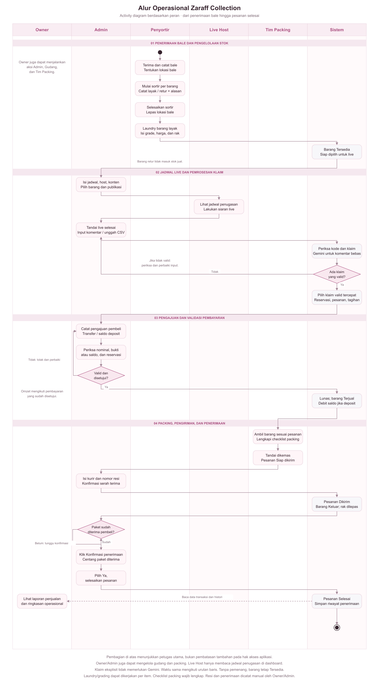

# Activity diagram alur operasional utama

Alur dari penerimaan bale hingga pesanan diterima pembeli, mengikuti perilaku aplikasi saat ini. Nama peran pada aktivitas menunjukkan petugas yang menjalankannya; aktivitas otomatis ditandai sebagai Sistem.

## Gambar berdasarkan role

Unduh [PNG](activity-by-role.png) atau [SVG](activity-by-role.svg). SVG tetap tajam saat diperbesar. Kolom terpisah menunjukkan Owner, Admin, Penyortir, Live Host, Tim Packing, dan aktivitas otomatis Sistem. Diagram menempatkan aksi pada petugas utama; hak Owner/Admin untuk menjalankan aksi Gudang dan Packing tetap berlaku.

Gambar dapat dibuat ulang dengan `node scripts/activity-diagram.mjs`.

## Detail alur

```mermaid
flowchart TB
    mulai((Mulai))

    subgraph gudang ["Gudang — Penyortir / Owner / Admin"]
        terimaBale["Catat penerimaan bale dan lokasi penyimpanan"]
        mulaiSortir["Mulai sortir bale"]
        periksaBarang["Periksa kategori dan kondisi barang"]
        barangLayak{"Barang layak dijual?"}
        catatRetur["Catat retur beserta alasan"]
        catatLaundry["Catat barang masuk antrean laundry"]
        sisaBarang{"Masih ada barang untuk disortir?"}
        selesaiSortir["Selesaikan sortir dan lepas lokasi bale"]
        stokLayak{"Ada barang hasil sortir yang layak?"}
        laundry["Cuci dan periksa kebersihan barang"]
        grading["Tetapkan grade, harga, dan rak aktif"]
        tersedia["Sistem: barang berstatus Tersedia"]
    end

    subgraph penjualan ["Live dan penjualan — Owner / Admin"]
        jadwalLive["Isi jadwal, host, konten, dan kanal promosi"]
        pilihBarang["Pilih barang tersedia untuk sesi live"]
        publikasi["Publikasikan jadwal live"]
        siaran["Live Host: lihat jadwal penugasan dan lakukan siaran di platform live"]
        selesaiLive["Owner / Admin: tandai sesi live selesai"]
        imporKomentar["Masukkan komentar manual atau unggah CSV"]
        periksaKlaim["Sistem: periksa identitas, waktu, kode, dan maksud klaim"]
        klaimValid{"Ada klaim valid untuk barang sesi ini?"}
        koreksiKomentar["Periksa sumber komentar dan perbaiki input"]
        pemenang["Sistem: pilih klaim valid paling awal per barang"]
        buatPesanan["Sistem: reservasi barang, buat pesanan dan tagihan"]
    end

    subgraph pembayaran ["Pembayaran — Owner / Admin"]
        ajukanBayar["Catat pengajuan pembayaran pembeli"]
        metodeBayar{"Metode pembayaran?"}
        transfer["Unggah bukti transfer dan catat nominal"]
        deposit["Pilih pembayaran dengan saldo deposit"]
        validasiBayar["Validasi nominal, bukti atau saldo, dan reservasi barang"]
        bayarValid{"Pembayaran valid dan disetujui?"}
        perbaikiBayar["Tolak dengan alasan atau lengkapi pengajuan"]
        lunas["Sistem: pesanan Lunas dan barang Terjual; potong saldo jika deposit"]
    end

    subgraph pengiriman ["Packing dan pengiriman"]
        packing["Tim Packing / Owner / Admin: ambil barang dan lengkapi checklist"]
        cekPacking{"Kode, kondisi, dan kemasan sudah sesuai?"}
        perbaikiPacking["Lengkapi atau perbaiki checklist"]
        dikemas["Tandai dikemas; pesanan masuk Siap dikirim"]
        resi["Owner / Admin: isi kurir dan nomor resi"]
        serahTerima["Owner / Admin: konfirmasi serah terima ke kurir"]
        keluarGudang["Sistem: pesanan Dikirim, barang Keluar Gudang, rak dilepas"]
        diterima{"Paket sudah diterima pembeli?"}
        tungguPaket["Tetap dalam pengiriman; tunggu konfirmasi penerimaan"]
        konfirmasi["Owner / Admin: klik Konfirmasi penerimaan dan centang paket diterima"]
        selesaikan["Owner / Admin: pilih Ya, selesaikan pesanan"]
        pesananSelesai["Sistem: pesanan Selesai dan riwayat penerimaan tersimpan"]
    end

    akhir((Selesai))
    mulai --> terimaBale --> mulaiSortir --> periksaBarang --> barangLayak
    barangLayak -->|Ya| catatLaundry --> sisaBarang
    barangLayak -->|Tidak| catatRetur --> sisaBarang
    sisaBarang -->|Ya| periksaBarang
    sisaBarang -->|Tidak| selesaiSortir --> stokLayak
    stokLayak -->|Tidak| akhir
    stokLayak -->|Ya| laundry --> grading --> tersedia
    tersedia --> jadwalLive --> pilihBarang --> publikasi --> siaran --> selesaiLive
    selesaiLive --> imporKomentar --> periksaKlaim --> klaimValid
    klaimValid -->|Tidak| koreksiKomentar --> imporKomentar
    klaimValid -->|Ya| pemenang --> buatPesanan --> ajukanBayar --> metodeBayar
    metodeBayar -->|Transfer| transfer --> validasiBayar
    metodeBayar -->|Deposit| deposit --> validasiBayar
    validasiBayar --> bayarValid
    bayarValid -->|Tidak| perbaikiBayar --> ajukanBayar
    bayarValid -->|Ya| lunas --> packing --> cekPacking
    cekPacking -->|Tidak| perbaikiPacking --> packing
    cekPacking -->|Ya| dikemas --> resi --> serahTerima --> keluarGudang --> diterima
    diterima -->|Belum| tungguPaket --> diterima
    diterima -->|Sudah| konfirmasi --> selesaikan --> pesananSelesai --> akhir

    classDef action fill:#fff5f8,stroke:#d8b3c5,color:#35232d
    classDef decision fill:#f9e8ef,stroke:#a94d7e,color:#35232d
    classDef terminal fill:#a94d7e,stroke:#a94d7e,color:#ffffff
    class terimaBale,mulaiSortir,periksaBarang,catatRetur,catatLaundry,selesaiSortir,laundry,grading,tersedia,jadwalLive,pilihBarang,publikasi,siaran,selesaiLive,imporKomentar,periksaKlaim,koreksiKomentar,pemenang,buatPesanan,ajukanBayar,transfer,deposit,validasiBayar,perbaikiBayar,lunas,packing,perbaikiPacking,dikemas,resi,serahTerima,keluarGudang,tungguPaket,konfirmasi,selesaikan,pesananSelesai action
    class barangLayak,sisaBarang,stokLayak,klaimValid,metodeBayar,bayarValid,cekPacking,diterima decision
    class mulai,akhir terminal
```

## Aturan penting

- Sortir berulang untuk setiap barang. Retur di aplikasi adalah pencatatan hasil sortir dan alasan, bukan pelacakan pengembalian fisik ke supplier. Barang layak dapat diproses laundry/grading per item; diagram mengelompokkannya setelah sortir agar mudah dibaca.
- Live Host hanya melihat jadwal yang ditugaskan. Siaran berlangsung di luar dashboard; publikasi aplikasi mencatat jadwal/promosi internal. Owner/Admin mengelola sesi, impor klaim, dan pesanan.
- Gemini memeriksa kode dan maksud komentar dari input manual atau CSV komentar. Klaim eksplisit dengan kolom `handle,kode,waktu` serta form Tambah manual diproses tanpa Gemini. Pemenang selalu ditentukan sistem berdasarkan waktu valid paling awal; waktu identik mengikuti urutan baris sumber. Klaim tidak valid/kalah tidak membuat pesanan; barang tanpa pemenang tetap tersedia.
- Pembayaran yang masih menunggu validasi belum masuk antrean packing. Persetujuan pembayaran mengubah barang menjadi Terjual dan memperbarui omzet; pengiriman tidak menghitung penjualan lagi.
- Tim Packing tidak mengisi resi, menyerahkan pesanan ke kurir melalui aplikasi, atau menyelesaikan pesanan. Owner/Admin melakukan tindakan tersebut. Penerimaan dikonfirmasi manual di **Pengiriman → Dalam pengiriman**, karena belum ada integrasi status kurir.
- Laporan membaca data transaksi dan histori yang sama; tidak ada langkah input ulang laporan di akhir alur.

Rujukan: [Gudang](warehouse.md), [Penjualan](sales.md), [Pembayaran](payments.md), dan [Pengiriman](shipping.md).
