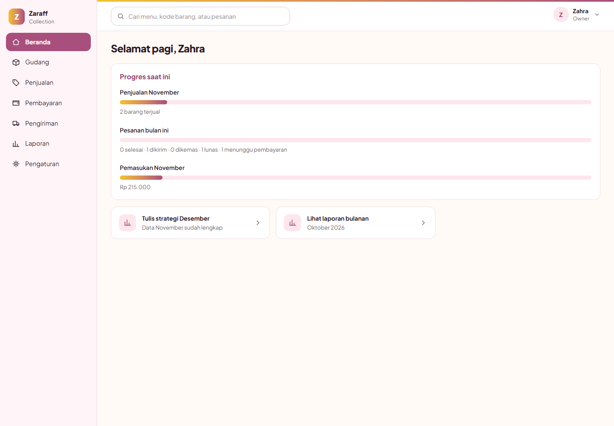
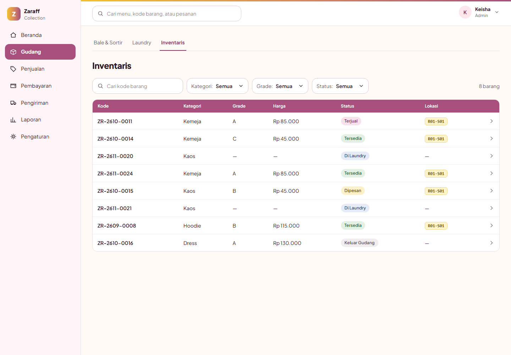
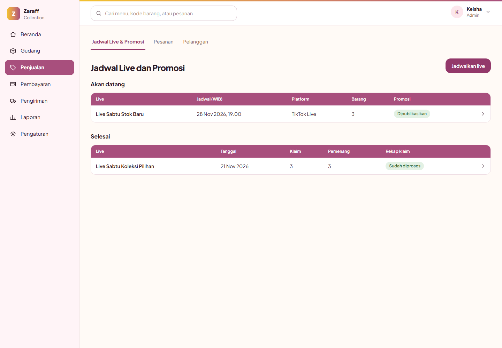
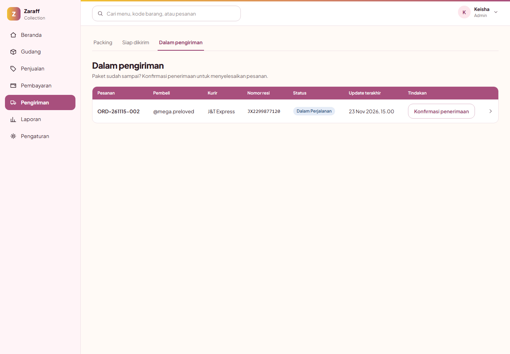

# Screenshot aplikasi terbaru

Diambil langsung dari aplikasi lokal pada 25 November 2026, menggunakan data yang tersimpan saat pengambilan. Lebar desktop 1440 px, tinggi viewport 1000 px; gambar mencakup seluruh tinggi halaman. Tidak ada transaksi operasional yang diubah untuk menyiapkan tampilan.

Folder diurutkan berdasarkan modul. Nama file memakai urutan dan nama halaman; beranda dipisah untuk kelima role. Antrean kosong mencerminkan data aktual saat screenshot, bukan halaman yang belum diimplementasikan.

## 01-autentikasi

| Tampilan                                             | Role  | Route    |
| ---------------------------------------------------- | ----- | -------- |
| [Halaman login](01-autentikasi/01-halaman-login.png) | guest | `/masuk` |

## 02-beranda

| Tampilan                                                 | Role      | Route      |
| -------------------------------------------------------- | --------- | ---------- |
| [Beranda Owner](02-beranda/01-beranda-owner.png)         | owner     | `/beranda` |
| [Beranda Admin](02-beranda/02-beranda-admin.png)         | admin     | `/beranda` |
| [Beranda penyortir](02-beranda/03-beranda-penyortir.png) | penyortir | `/beranda` |
| [Beranda live-host](02-beranda/04-beranda-live-host.png) | live-host | `/beranda` |
| [Beranda packing](02-beranda/05-beranda-tim-packing.png) | packing   | `/beranda` |

## 03-gudang

| Tampilan                                                | Role  | Route                                  |
| ------------------------------------------------------- | ----- | -------------------------------------- |
| [Daftar bale dan sortir](03-gudang/01-daftar-bale.png)  | admin | `/gudang/bale`                         |
| [Form terima bale](03-gudang/02-terima-bale.png)        | admin | `/gudang/bale/baru`                    |
| [Antrean laundry](03-gudang/03-antrean-laundry.png)     | admin | `/gudang/laundry`                      |
| [Inventaris barang](03-gudang/04-inventaris-barang.png) | admin | `/gudang/inventaris`                   |
| [Detail bale](03-gudang/05-detail-bale.png)             | admin | `/gudang/bale/BL-261124-001`           |
| [Detail barang](03-gudang/06-detail-barang.png)         | admin | `/gudang/inventaris/ZR-2610-0014`      |
| [Grading barang](03-gudang/07-grading-barang.png)       | admin | `/gudang/laundry/ZR-2611-0020/grading` |

## 04-penjualan

| Tampilan                                                           | Role      | Route                                           |
| ------------------------------------------------------------------ | --------- | ----------------------------------------------- |
| [Jadwal live dan promosi](04-penjualan/01-jadwal-live.png)         | admin     | `/penjualan/live`                               |
| [Daftar pesanan](04-penjualan/02-daftar-pesanan.png)               | admin     | `/penjualan/pesanan`                            |
| [Daftar pelanggan](04-penjualan/03-daftar-pelanggan.png)           | admin     | `/penjualan/pelanggan`                          |
| [Detail live dipublikasikan](04-penjualan/04-detail-live.png)      | admin     | `/penjualan/live/live-small-261128`             |
| [Impor komentar live](04-penjualan/05-impor-komentar.png)          | admin     | `/penjualan/live/live-small-261121/klaim/impor` |
| [Hasil klaim live](04-penjualan/06-hasil-klaim.png)                | admin     | `/penjualan/live/live-small-261121/klaim`       |
| [Detail pesanan](04-penjualan/07-detail-pesanan.png)               | admin     | `/penjualan/pesanan/ORD-261115-002`             |
| [Detail pelanggan](04-penjualan/08-detail-pelanggan.png)           | admin     | `/penjualan/pelanggan/customer-rina`            |
| [Jadwal penugasan Live Host](04-penjualan/09-jadwal-live-host.png) | live-host | `/penjualan/live`                               |

## 05-pembayaran

| Tampilan                                                             | Role  | Route                                |
| -------------------------------------------------------------------- | ----- | ------------------------------------ |
| [Antrean validasi pembayaran](05-pembayaran/01-antrean-validasi.png) | admin | `/pembayaran/validasi`               |
| [Tagihan belum dibayar](05-pembayaran/02-tagihan-belum-dibayar.png)  | admin | `/pembayaran/tagihan`                |
| [Detail tagihan](05-pembayaran/03-detail-tagihan.png)                | admin | `/pembayaran/tagihan/INV-261121-004` |

## 06-pengiriman

| Tampilan                                                          | Role    | Route                                |
| ----------------------------------------------------------------- | ------- | ------------------------------------ |
| [Antrean packing](06-pengiriman/01-antrean-packing.png)           | admin   | `/pengiriman/packing`                |
| [Pesanan siap dikirim](06-pengiriman/02-siap-dikirim.png)         | admin   | `/pengiriman/siap-dikirim`           |
| [Pesanan dalam pengiriman](06-pengiriman/03-dalam-pengiriman.png) | admin   | `/pengiriman/dalam-pengiriman`       |
| [Checklist Tim Packing](06-pengiriman/04-checklist-packing.png)   | packing | `/pengiriman/packing/ORD-261121-001` |

## 07-laporan

| Tampilan                                                          | Role  | Route                     |
| ----------------------------------------------------------------- | ----- | ------------------------- |
| [Ringkasan bisnis](07-laporan/01-ringkasan-bisnis.png)            | admin | `/laporan/ringkasan`      |
| [Laporan bulanan](07-laporan/02-laporan-bulanan.png)              | admin | `/laporan/bulanan`        |
| [Gudang dan umur stok](07-laporan/03-umur-stok.png)               | admin | `/laporan/umur-stok`      |
| [Barang terjual dan keluar](07-laporan/04-terjual-dan-keluar.png) | admin | `/laporan/terjual-keluar` |
| [Strategi bulanan](07-laporan/05-strategi-bulanan.png)            | admin | `/laporan/strategi`       |

## 08-pengaturan

| Tampilan                                                      | Role  | Route                |
| ------------------------------------------------------------- | ----- | -------------------- |
| [Aturan harga](08-pengaturan/01-aturan-harga.png)             | admin | `/pengaturan/harga`  |
| [Diskon member](08-pengaturan/02-diskon-member.png)           | admin | `/pengaturan/diskon` |
| [Lokasi penyimpanan](08-pengaturan/03-lokasi-penyimpanan.png) | admin | `/pengaturan/lokasi` |

## Pratinjau

### Beranda Owner

### Inventaris barang

### Jadwal live dan promosi

### Pesanan dalam pengiriman

Detail route, role, dimensi, dan waktu pengambilan tersedia di [manifest.json](manifest.json). Screenshot ini adalah dokumentasi tampilan, bukan sumber data aplikasi.
